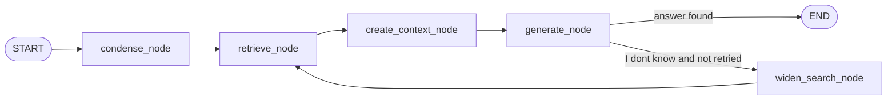

# DocGraph

Chat with any PDF. Built as a LangGraph state graph with retrieval-grounded, streamed answers, chat memory and multiple chats.

## Features

- **Upload any PDF** in the UI (or reuse one already uploaded in the session)
- **Streaming answers**, token by token
- **Chat memory**: follow-up questions work ("what about the second one?"), and the model knows earlier questions
- **Multiple chats**: "New chat" button, each chat bound to its own PDF
- **Voice interface in Hindi and English**: ask by speaking (Groq Whisper speech-to-text) and listen to answers (browser text-to-speech). Answers can be generated in English or Hindi (Devanagari), or auto-matched to the language of the question; Hindi questions are translated to English for retrieval
- **Grounded answers**: facts come only from retrieved context, otherwise "I dont know."
- **Retry edge**: if the first answer is "I dont know", retrieval is widened (k=6 -> 10) and tried once more
- **Rate-limit safe indexing**: batched embeddings with wait-and-retry on 429; index cached on disk per PDF (by content hash)

## Flow



- `condense_node` rewrites a follow-up question into a standalone one using chat history, so retrieval works on follow-ups.
- `generate_node` streams tokens to the UI (LangGraph `stream_mode="messages"`).

## Stack

LangGraph, LangChain, Gemini embeddings (`gemini-embedding-001`), Groq (`openai/gpt-oss-120b`, `whisper-large-v3` for speech-to-text), `InMemoryVectorStore`, pypdf, Streamlit.

## Design decisions

- **Chunking:** 800 chars / 100 overlap keeps sections of short documents separate.
- **Index cache:** keyed by SHA-256 of the PDF bytes, so the same file is never embedded twice.
- **Memory:** only the last 6 messages are sent to the model, so the prompt stays small.
- **Voice:** speech-to-text runs on Groq; text-to-speech uses the browser's built-in voices (free, no quota), so the voice depends on the OS/browser and needs a click to play.
- **Scope:** scanned/image-only PDFs are not supported (no OCR).

## Setup

```bash
pip install -r requirements.txt
cp .env.example .env     # add GOOGLE_API_KEY and GROQ_API_KEY
```

Optional: set `LLM_MODEL` / `STT_MODEL` in `.env` to change the Groq chat / speech-to-text model.

## Run

```bash
streamlit run app.py                      # web UI
python rag_graph.py path/to/file.pdf      # CLI
```

## Limitations

- Chats live in the browser session; refreshing the page clears them (the embedding cache stays on disk).
- Questions that need counting or aggregating across the whole document can be incomplete, since only the top-k chunks are retrieved.

## Live demo

https://YOUR-APP-NAME.streamlit.app  (free hosting, may take ~30s to wake up)

Limits on the public demo: PDFs up to 5 MB and 30 pages (configurable via `MAX_PDF_MB` and `MAX_PAGES`).